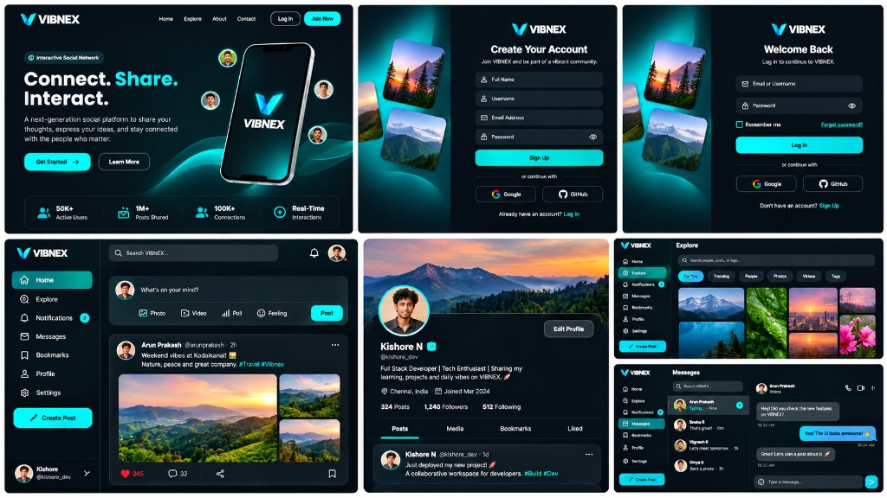
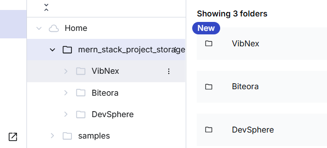

# VIBNEX — Interactive Social Networking Platform

<div align="center">



<br/>

[](https://vib-g4ytxl9n8-nexus-forge1.vercel.app/)
[](https://react.dev/)
[](https://nodejs.org/)
[](https://www.mongodb.com/atlas)
[](https://cloudinary.com/)
[](https://tailwindcss.com/)
[](LICENSE)

**Connect. Share. Interact.**  
*A next-generation, high-performance social networking platform engineered with the MERN stack, Socket.IO real-time bi-directional events, modern cyber-teal aesthetics, Cloudinary CDN asset storage, direct messaging, and an isolated staff administration command hub.*

</div>

---

### 👨‍💻 Sole Author & Maintainer

- **Sole Contributor:** **Nandhakishore A**
- **Email:** [nandhakishore252@gmail.com](mailto:nandhakishore252@gmail.com)
- **GitHub Profile:** [@Nandhakishore-A](https://github.com/Nandhakishore-A)
- **Repository:** [https://github.com/Nandhakishore-A/VibNex](https://github.com/Nandhakishore-A/VibNex)

---

## 🌐 Live Vercel Deployments

Experience the live, production-deployed VIBNEX ecosystem across its independent cloud surfaces:

| Surface | Direct URL | Description & Access |
| :--- | :--- | :--- |
| 🚀 **Consumer Web App (Production)** | [vib-g4ytxl9n8-nexus-forge1.vercel.app](https://vib-g4ytxl9n8-nexus-forge1.vercel.app/) | Primary consumer web application, landing experience, and social feed |
| 🌐 **Client Web Application** | [vib-nex-5egb-qgg8u936h-nexus-forge1.vercel.app](https://vib-nex-5egb-qgg8u936h-nexus-forge1.vercel.app/) | Interactive landing page, authentication, feed, profile, and messaging |
| 🛡️ **Staff Administration Console** | [vib-nex-pk9o-nvqoj4q4i-nexus-forge1.vercel.app/login](https://vib-nex-pk9o-nvqoj4q4i-nexus-forge1.vercel.app/login) | Dedicated administrative portal for staff moderation and telemetry |
| ⚡ **Backend REST API** | [vib-oh76nqalc-nexus-forge1.vercel.app/api/health](https://vib-oh76nqalc-nexus-forge1.vercel.app/api/health) | Serverless Express API health check and microservice gateway |

> [!NOTE]
> When accessing Vercel deployment preview links directly, if Vercel Authentication Protection is enabled on your project team, sign in with your Vercel account or promote the deployment to your custom production alias for public unauthenticated access.

---

## 📸 UI Design & Experience Showcase

VIBNEX delivers a distinctive, cyber-teal aesthetic (`#070A0F`, `#0E1520`, `#06B6D4`, `#00F2FE`) combining fluid micro-interactions with high-speed performance:


### 💎 Signature Interface Modules:
1. **Interactive 3D Landing Experience (`/landing`):**
   - Perspective-tilted 3D mobile application mockup with ambient cyan glow and floating user indicators.
   - Live interactive demo post with animated heart-counter, quick category pills (*All, Photography, Travel, Tech, Nature*), and real-time counter metrics.
   - Key platform metrics: **50K+ Active Users**, **1M+ Posts Shared**, **100K+ Connections**, **<50ms Real-Time Latency**.
2. **Authentication Suite & 1-Click Social Logins (`/login`, `/register`):**
   - Split-screen visual layouts with floating scenic imagery, glassmorphic cards, and email/password validation.
   - 1-click **Google** and **GitHub** social login flows powered by `POST /api/auth/social`.
   - Secure cryptographic token-based email verification and password reset workflows.
3. **Personalized Feed & Rich Composer (`/`):**
   - 3-column desktop layout (Left Navigation, Main Timeline, Right Discovery Widget).
   - Rich post creator supporting multi-media uploads, captions, polls, and feelings.
   - Interactive post cards with like pulse animations, instant comments, bookmarks, and copy-link triggers.
4. **Real-Time Direct Messaging (`/messages`):**
   - Sub-50ms Socket.IO bi-directional chat system with active contact lists and live presence indicators.
   - Typing indicators, message history retention, and unread counters.
5. **Explore & User Profiles (`/explore`, `/profile/:username`):**
   - Category filter pills (*For You, Trending, People, Photos, Videos, Tags*).
   - Panoramic cover photos, verified profile badges, follow/unfollow relationship graph, and tabbed archives (*Posts, Media, Bookmarks, Liked*).
6. **Isolated Staff Administration Console (`admin/`):**
   - Live telemetry KPI cards, MongoDB Atlas connection health, user moderation (block/unblock, delete), post moderation (hide/unhide), and comment audit logs.

---

## ☁️ Cloudinary Media Architecture

VIBNEX utilizes Cloudinary CDN for optimized, responsive media transformation, automated WebP delivery, and organized cloud folder structures:

<div align="center">



</div>

### Storage Organization:
```text
mern_stack_project_storage/
└── VibNex/
    ├── avatars/     # User profile photos and avatars
    ├── covers/      # Panoramic cover banners
    └── posts/       # Post attachments, photography, and video media
```

---

## 💻 Technology Stack

| Layer | Technologies |
| :--- | :--- |
| **Frontend Web Client** | React 19, Vite 8, Tailwind CSS v4, Lucide React Icons, React Router 7, Axios, Socket.IO Client, React Hot Toast |
| **Admin Console** | React 19, Vite 8, Tailwind CSS v4, Lucide React Icons, React Router 7, Axios |
| **Backend REST API** | Node.js (ES Modules), Express 5, Socket.IO 4, Mongoose 9, Helmet, Express-Rate-Limit, BCryptJS, JSONWebToken, Swagger UI |
| **Database** | MongoDB Atlas (Production Cluster `cluster0.9dyssq7.mongodb.net/VibNex`) |
| **Media CDN Storage** | Cloudinary CDN (`mern_stack_project_storage/VibNex`) |
| **Deployment & Hosting**| Vercel Serverless Functions (`server`), Vercel Static Edge Hosting (`client`, `admin`) |
| **Design Tokens** | Cyber Teal & Slate (`#070A0F`, `#0E1520`, `#1E293B`, `#06B6D4`, `#00F2FE`) |

---

## 📁 Repository Directory Structure

```text
VibNex/
├── client/                     # Consumer Web Application (React 19 + Vite 8)
│   ├── src/
│   │   ├── api/axios.js               # Axios instance with JWT interceptors
│   │   ├── assets/                    # VIBNEX vector logos & branding assets
│   │   ├── components/
│   │   │   ├── layout/                # LeftSidebar, RightSidebar, MainLayout, Navbar, Footer
│   │   │   ├── post/                  # PostCard, CreatePostForm, CommentItem, PostGrid
│   │   │   └── ui/                    # Logo, Avatar, Button, Input, Modal, Dropdown
│   │   ├── context/                   # AuthContext, SocketContext, NotificationContext
│   │   ├── pages/
│   │   │   ├── landing/LandingPage.jsx    # Hero section with 3D mobile showcase & stats
│   │   │   ├── auth/Login.jsx             # Split-screen login with Google/GitHub buttons
│   │   │   ├── auth/Register.jsx          # Account creation with social login
│   │   │   ├── feed/FeedPage.jsx          # Personalized timeline & post composer
│   │   │   ├── messages/MessagesPage.jsx  # Live Socket.IO direct messaging chat
│   │   │   ├── explore/ExplorePage.jsx    # Discovery with category filter pills
│   │   │   └── profile/ProfilePage.jsx    # User profile with cover art & verification
│   │   ├── App.jsx                    # React Router 7 route tree
│   │   └── index.css                  # VIBNEX Tailwind v4 design tokens
│   ├── vercel.json                    # Single Page Application SPA rewrite config
│   ├── package.json
│   └── vite.config.js
│
├── admin/                      # Standalone Staff Administration Console
│   ├── src/
│   │   ├── components/AdminLayout.jsx # Staff layout & navigation
│   │   ├── context/AdminAuthContext.jsx # Admin session token management
│   │   ├── pages/
│   │   │   ├── AdminLogin.jsx         # Staff credential portal
│   │   │   ├── DashboardPage.jsx      # Telemetry KPI cards & growth analytics
│   │   │   ├── UsersPage.jsx          # User moderation & account management
│   │   │   ├── PostsPage.jsx          # Post content moderation & removal
│   │   │   └── CommentsPage.jsx       # Comment audit & cleanup
│   │   └── App.jsx
│   ├── vercel.json                    # Admin SPA rewrite config
│   ├── package.json
│   └── vite.config.js
│
├── server/                     # Node.js + Express 5 + Socket.IO Backend
│   ├── config/
│   │   ├── db.js                      # MongoDB Atlas connection manager (caching for serverless)
│   │   ├── env.js                     # Environment variables validation
│   │   └── cloudinary.js              # Cloudinary buffer streaming SDK
│   ├── controllers/
│   │   ├── authController.js          # Register, login, social auth, password reset
│   │   ├── messageController.js       # Real-time direct messaging CRUD
│   │   ├── postController.js          # Post publishing & Cloudinary cascade
│   │   ├── userController.js          # Profile updates & follow relationships
│   │   └── adminController.js         # Staff platform analytics & moderation
│   ├── models/                        # Mongoose 9 models (User, Post, Comment, Notification, Message)
│   ├── routes/                        # Express 5 endpoint routers
│   ├── socket/                        # Socket.IO connection manager & auth
│   ├── seed/                          # adminSeed.js & demoSeed.js
│   ├── index.js                       # HTTP server bootstrap & serverless export
│   ├── vercel.json                    # Vercel serverless builds and route rewrites
│   └── package.json
│
├── docs/
│   └── screenshots/                   # Production UI mockups and architecture diagrams
└── README.md
```

---

## 🛠️ Local Installation & Development

### 1. Clone the Repository
```bash
git clone https://github.com/Nandhakishore-A/VibNex.git
cd VibNex
```

### 2. Configure Environment Variables

Create `.env` inside `server/` using `server/.env.example` as a template:
```env
PORT=5000
NODE_ENV=development
MONGO_URI=mongodb+srv://<username>:<password>@<cluster>.mongodb.net/VibNex?retryWrites=true&w=majority
JWT_SECRET=your_super_secret_jwt_key_at_least_32_characters
JWT_EXPIRES_IN=7d
CLIENT_URL=http://localhost:5173
ADMIN_URL=http://localhost:5174
CLOUDINARY_CLOUD_NAME=your_cloudinary_cloud_name
CLOUDINARY_API_KEY=your_cloudinary_api_key
CLOUDINARY_API_SECRET=your_cloudinary_api_secret
CLOUDINARY_FOLDER=mern_stack_project_storage/VibNex
ADMIN_EMAIL=admin@vibnex.dev
ADMIN_USERNAME=vibnexadmin
ADMIN_PASSWORD=your_secure_admin_password
```

Inside `client/.env`:
```env
VITE_API_URL=http://localhost:5000/api
VITE_SOCKET_URL=http://localhost:5000
```

Inside `admin/.env`:
```env
VITE_API_URL=http://localhost:5000/api
```

### 3. Run Development Servers
```bash
# Terminal 1: Backend API
cd server && npm run dev

# Terminal 2: Consumer Web App
cd client && npm run dev

# Terminal 3: Admin Console
cd admin && npm run dev
```

---

## 🚀 Deployment on Vercel

VIBNEX is pre-configured for seamless deployment across three distinct Vercel projects:

### 1. Backend API (`server/`)
- **Framework Preset:** Other
- **Root Directory:** `server`
- **Build Command:** *(Leave empty)*
- **Output Directory:** `.`
- **Environment Variables:**
  - `MONGO_URI`, `JWT_SECRET`, `JWT_EXPIRES_IN`, `NODE_ENV=production`
  - `CLIENT_URL=https://vib-g4ytxl9n8-nexus-forge1.vercel.app`
  - `ADMIN_URL=https://vib-nex-pk9o-nvqoj4q4i-nexus-forge1.vercel.app`
  - `CLOUDINARY_CLOUD_NAME`, `CLOUDINARY_API_KEY`, `CLOUDINARY_API_SECRET`, `CLOUDINARY_FOLDER`

### 2. Client Application (`client/`)
- **Framework Preset:** Vite
- **Root Directory:** `client`
- **Build Command:** `npm run build`
- **Output Directory:** `dist`
- **Environment Variables:**
  - `VITE_API_URL=https://vib-oh76nqalc-nexus-forge1.vercel.app/api`
  - `VITE_SOCKET_URL=https://vib-oh76nqalc-nexus-forge1.vercel.app`

### 3. Staff Admin Console (`admin/`)
- **Framework Preset:** Vite
- **Root Directory:** `admin`
- **Build Command:** `npm run build`
- **Output Directory:** `dist`
- **Environment Variables:**
  - `VITE_API_URL=https://vib-oh76nqalc-nexus-forge1.vercel.app/api`

---

## 📄 License
This project is licensed under the MIT License — authored and maintained solely by **Nandhakishore A**.
